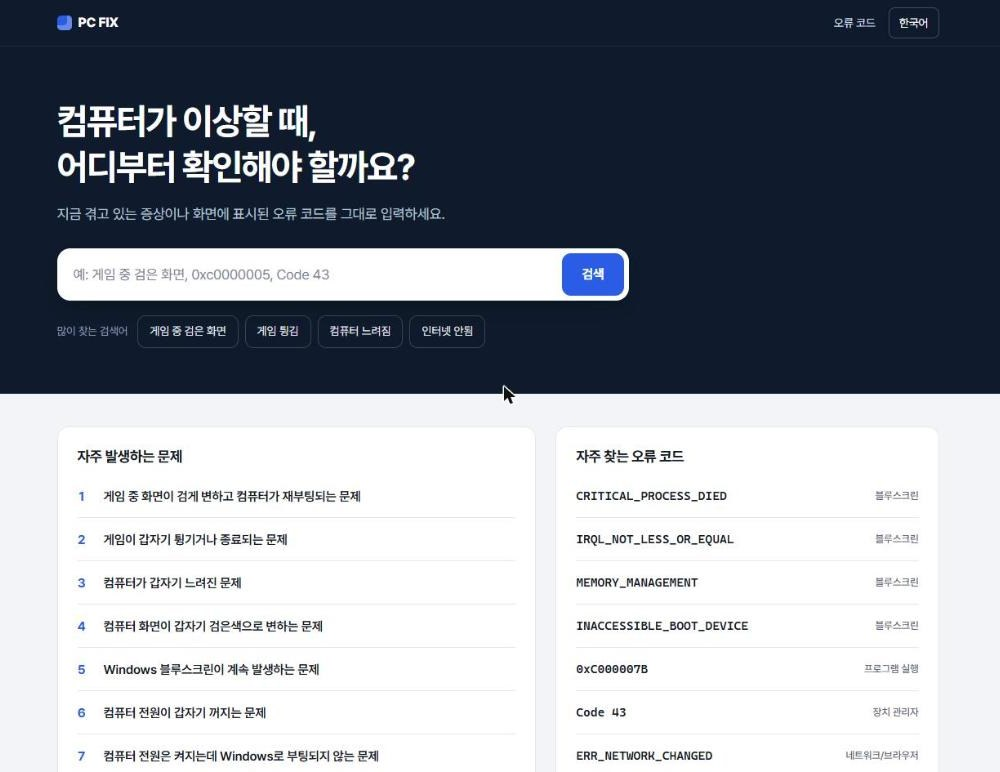
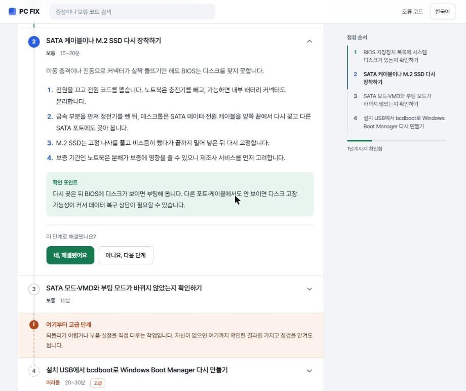

# PC FIX

컴퓨터에 나타난 증상이나 오류 코드를 검색하면 원인 후보와 확인 순서를 단계별로 안내하는 다국어 웹 서비스입니다. 기획, 구현, 배포, 운영을 혼자 맡고 있습니다.

**운영 서비스:** [pcfixbase.com](https://pcfixbase.com/)



## 한눈에 보기

| 항목 | 내용 |
| --- | --- |
| 콘텐츠 | 증상 217개, 오류 코드 80개, 카테고리 18개 |
| 언어 | 한국어, 영어, 일본어, 중국어 간체 |
| 공개 URL | 사이트맵 기준 1,284개 |
| 기술 | Next.js 16 App Router, React 19, TypeScript, Tailwind CSS 4 |
| 운영 | Ubuntu 홈서버, Docker Compose, Cloudflare |

## 주요 기능

### 한 번에 한 단계씩 따라가는 해결 안내



컴퓨터가 고장 난 사람은 긴 글을 차분히 읽기 어렵습니다. 그래서 해결 방법을 한 단계씩 열어 보여 줍니다.

- "아니요, 다음 단계"를 누르면 지금 단계가 접히고 다음 단계가 열립니다.
- 되돌리기 어렵거나 부품을 다루는 단계 앞에는 고급 단계 안내가 나옵니다.
- 넓은 화면은 오른쪽에 점검 순서를, 휴대폰은 상단에 진행 띠를 보여 줍니다.
- 진행 상태는 이 화면 안에서만 쓰고 저장하거나 서버로 보내지 않습니다.

### 증상과 오류 코드를 함께 찾는 통합 검색

`게임하다 검은화면 재부팅`, `0xc0000005`, `Code 43`을 같은 검색창에서 처리합니다.

- 제목, 키워드, 증상에서 후보를 추린 뒤 문자열과 한글 자모 유사도로 순위를 매깁니다.
- 정확한 오류 코드를 입력하면 오류 문서를 먼저 보여 줍니다.
- 검색어를 URL(`?q=`)에 저장해 상세 문서에서 돌아와도 결과가 유지됩니다.

### 4개 언어 정적 페이지

- 한국어 소스에서 언어별 라우트와 컴포넌트를 생성합니다.
- 번역은 JSON 사전에 저장해, 이용자가 페이지를 볼 때 외부 번역 API를 호출하지 않습니다.
- 언어를 바꿔도 현재 문서와 검색어가 유지됩니다.
- 언어별 canonical, hreflang, 구조화 데이터와 사이트맵을 제공합니다.

## 운영하며 해결한 문제

| 문제 | 확인한 원인 | 조치 |
| --- | --- | --- |
| 휴대폰에서 광고 오류 발생 | `adsbygoogle.push()`가 화면에 숨겨진 광고 자리를 먼저 잡음 | 자리가 실제로 보일 때만 광고 태그 생성 |
| 페이지마다 본문이 비슷함 | 공통 틀로 생성한 문장이 반복됨 | 한국어 297개 문서를 증상별 안내로 재작성하고 전수 검수 |
| 검색 색인 감소 | 언어·문서 종류별로 나눠 보니 한국어 원문의 감소가 가장 큼 | 번역 페이지는 유지하고 한국어 본문 보강. **회복 여부는 확인 중** |
| 의존성 보안 경고 | 사용 중인 Next.js 버전에 공개 취약점 존재 | 패치 버전으로 업데이트하고 운영 의존성 감사 통과 |
| JSON-LD 이스케이프 누락 | `"\u003c"`가 JS에서 `<`로 해석되어 치환이 동작하지 않음 | `"\\u003c"`로 수정 |

## 코드 살펴보기

| 파일 | 확인할 내용 |
| --- | --- |
| [components/GuidedSteps.tsx](components/GuidedSteps.tsx) | 단계 접기, 진행 표시, 고급 단계 안내 |
| [lib/search.ts](lib/search.ts) | 증상 후보 추출과 유사도 계산 |
| [lib/unifiedSearch.ts](lib/unifiedSearch.ts) | 증상·오류 결과 통합과 우선순위 |
| [lib/koGuide.ts](lib/koGuide.ts) | 한국어 전용 안내 적용 |
| [lib/localization.ts](lib/localization.ts) | 언어별 경로와 대체 언어 링크 |
| [scripts/generate-locales.mjs](scripts/generate-locales.mjs) | 한국어 소스에서 언어별 페이지 생성 |
| [components/DisplayAd.tsx](components/DisplayAd.tsx) | 보이는 자리에만 광고 요청 |
| [app/sitemap.ts](app/sitemap.ts) | 데이터 기반 다국어 사이트맵 |
| [scripts/check-errors.mjs](scripts/check-errors.mjs) | 검색, 데이터, 링크, 사이트맵 회귀 검사 |

## 로컬 실행

```sh
npm ci
npm run dev
```

[localhost:3000](http://localhost:3000)에서 확인합니다.

## 검증

```sh
node scripts/check-errors.mjs
node scripts/check-locales.mjs
npx tsc --noEmit
npm run lint
npm run build
```

- `check-errors`: 증상·오류 개수, 코드 검색 우선순위, 관련 링크, 메타데이터, 사이트맵
- `check-locales`: 번역 누락, 명령어·오류 코드·slug 보존, 언어별 검색과 링크

## 콘텐츠와 AI 활용

- 개발과 콘텐츠 작성에 Codex와 Claude Code를 활용했습니다.
- 한국어 안내는 AI로 초안을 쓰고, 명령어와 메뉴 경로를 공식 문서와 검수 과정으로 확인했습니다. PC 수리 전문가의 감수를 받은 내용은 아닙니다.
- 외국어 본문에는 기계 번역 초안이 포함되어 있으며 원어민 감수는 완료되지 않았습니다.
- 안내는 원인 후보와 확인 순서를 정리한 것으로, 고장 원인을 확정하는 진단이 아닙니다.

자세한 내용: [다국어 구조](docs/localization.md) · [보안 설정](docs/security.md)
